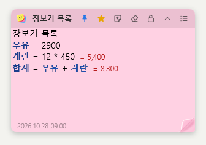
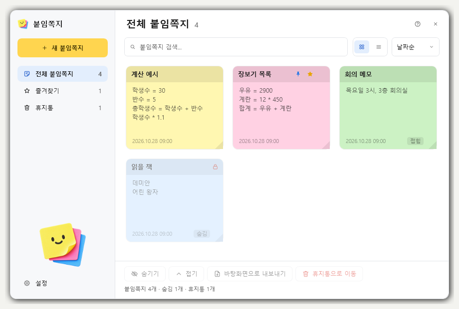

# 붙임쪽지 · Butim

**메모를 적으며 바로 계산하는 바탕화면 붙임쪽지.**

[English](README.md) · [다운로드](https://github.com/funk80/Butim/releases/latest) · [사용 설명서](docs/ko/user-guide.md) · [기술 참고 문서](docs/ko/technical-reference.md)

붙임쪽지(Butim)는 할 일, 회의 메모, 간단한 계산을 바탕화면에 붙여 두고 사용하는 Windows 메모 앱입니다. 메모마다 별도의 창으로 열리며 색상, 글꼴, 항상 위, 편집 잠금, 접기를 설정할 수 있습니다. 메모를 `.butim` 파일로 내보내고 더블클릭으로 다시 가져올 수도 있습니다.

**Windows 10/11 (x64) · 한국어·영어 지원 · 개인 및 기업 무료 사용**



## 다운로드 및 설치

1. [최신 릴리스](https://github.com/funk80/Butim/releases/latest)를 엽니다.
2. **Assets**에서 **Butim_Setup.exe**를 내려받습니다.
3. 설치 파일을 실행하고 안내에 따라 설치합니다.
4. Butim을 실행한 뒤 **Ctrl+Alt+N**을 눌러 새 붙임쪽지를 만듭니다.

.NET 10.0 Desktop Runtime (x64)이 없으면 함께 포함된 설치기로 설치합니다. 앱은 사용자 단위로 설치되며, 런타임 설치 시에는 관리자 권한 확인이 필요할 수 있습니다. 실행 후에는 알림 영역에 상주하고, 처음 실행하면 사용법 붙임쪽지가 열립니다.

## 주요 기능

| 기능 | 설명 |
| --- | --- |
| 메모 속 계산 | 변수, 사칙연산, 괄호, 거듭제곱, 백분율을 사용하고 줄 끝에서 결과를 확인합니다. |
| 메모별 꾸미기 | 8가지 색상과 글꼴을 선택하며 메모마다 크기와 위치를 기억합니다. |
| 창 상태 관리 | 항상 위에 두기, 편집 잠금, 제목줄만 남기는 접기, 숨기기를 지원합니다. |
| 자석 정렬 | 다른 메모나 작업 영역 가장자리에 맞춰 정렬합니다. `Alt`로 자석을 끕니다. |
| 붙임쪽지 관리 | 검색, 즐겨찾기, 정렬, 격자·목록 보기와 여러 메모의 일괄 작업을 지원합니다. |
| 파일 내보내기 | 바탕화면의 `.butim` 파일로 옮기고 더블클릭으로 다시 가져옵니다. |
| 휴지통 | 영구 삭제 전에 메모를 복원할 수 있습니다. |
| 언어와 테마 | 한국어·영어, 관리 창과 설정 창의 밝게·어둡게·시스템 테마를 지원합니다. |
| 자동 저장 | 입력을 잠시 멈추면 저장하고, 다시 실행하면 저장한 위치로 복원합니다. |

### 메모 안에서 계산

```text
단가 = 12000
수량 = 5
합계 = 단가 * 수량
할인가 = 합계 * (1 - 10%)
```

마지막 두 줄에 **60,000**, **54,000**이 표시됩니다. 식만 입력하면 결과는 자동으로 나타납니다. 날짜와 전화번호 형식은 기본적으로 계산에서 제외하며, 패턴 만들기 도우미로 다른 형식도 추가할 수 있습니다.

### 한곳에서 관리



### 내게 맞게 설정


이미지는 자동 실행을 끈 시험용 인스턴스의 화면입니다. 일반 사용 시 Windows 시작 시 자동 실행은 기본으로 켜져 있습니다.

## 기본 단축키

| 단축키 | 기능 |
| --- | --- |
| `Ctrl+Alt+N` | 새 붙임쪽지 |
| `Ctrl+Alt+M` | 모두 앞으로 |
| `Ctrl` + 마우스 휠 또는 `Ctrl` + `+` / `-` | 본문 편집 중 글꼴 크기 조절 |
| `Ctrl+0` | 기본 글꼴과 크기로 되돌리기 |
| `Alt` + 끌기 | 자석 정렬 없이 이동 |

위의 두 전역 단축키는 다른 프로그램을 사용하는 중에도 동작하며, 설정에서 변경할 수 있습니다.

## 상세 문서

설명은 **v1.9.2** 기준입니다. 다운로드할 버전은 릴리스 페이지에서 확인하세요.

- [사용 설명서](docs/ko/user-guide.md): 창 조작, 계산 규칙, 제외 패턴, 관리, 설정, 데이터, 문제 해결.
- [기술 참고 문서](docs/ko/technical-reference.md): 아키텍처, 저장 형식, 구현 방식, 빌드 요구사항.
- [문서 구성과 이미지 출처](docs/README.md): 언어별 문서와 향후 소스 코드의 배치 기준.
- [English overview](README.md) · [English user guide](docs/en/user-guide.md)

## 라이선스

개인 및 기업·기관 모두 업무 목적을 포함해 무료로 사용할 수 있습니다. 조직 내부 배포와 백업 목적의 복사를 허용합니다.

Butim은 비공개 소스 소프트웨어입니다. 현재 저장소에는 문서와 배포 자료를 제공하며 앱 소스는 포함하지 않습니다. 관련 법령이나 구성요소의 별도 라이선스에서 허용하는 경우를 제외하고 수정·외부 재배포·판매·대여·다른 제품에 포함한 배포에는 사전 허락이 필요합니다. 공식 다운로드 링크 공유는 허용합니다.

자세한 조건은 [LICENSE.txt](LICENSE.txt)를 참고하세요. 제3자 구성요소에는 각각의 라이선스가 적용됩니다.
