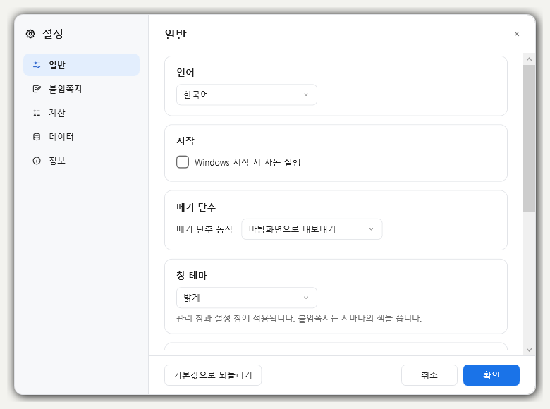

# 붙임쪽지(Butim) — 메모 속 계산을 지원하는 Windows 바탕화면 메모 앱

**메모를 적으며 바로 계산하는 바탕화면 붙임쪽지.**

[English](README.md) · [다운로드](https://github.com/funk80/Butim/releases/latest) · [사용 설명서](docs/ko/user-guide.md) · [오류 신고·기능 제안](https://github.com/funk80/Butim/issues/new/choose)

**붙임쪽지(Butim)는 계산기를 내장한 무료 Windows 바탕화면 메모 앱입니다.** 같은 메모 안에 글, 이름을 붙인 변수, 수식을 입력하면 줄 끝에 계산 결과가 자동으로 표시됩니다. Windows 10/11 x64, 한국어·영어 화면과 도움말, 로컬 메모 저장, `.butim` 파일 내보내기·가져오기를 지원합니다. 개인과 기업 모두 자체 사용권 약관에 따라 무료로 사용할 수 있으며, 소스 코드는 현재 공개하지 않습니다.

**Windows 10/11 (x64) · 한국어·영어 지원 · 개인 및 기업 무료 사용**

## 제품 정보

| 항목 | 내용 |
| --- | --- |
| 제품명 | 붙임쪽지, Butim, 붙임쪽지(Butim) |
| 분류 | 바탕화면 메모, 스티키 노트, 메모 속 수식 계산 프로그램 |
| 지원 환경 | Windows 10/11, x64 |
| 화면·도움말 언어 | 한국어, 영어 |
| 핵심 기능 | 메모 안에서 사칙연산과 이름을 붙인 변수를 계산하고 결과 표시 |
| 메모 관리 | 검색, 즐겨찾기, 격자·목록 보기, 정렬, 휴지통 복원 |
| 저장 위치 | PC의 `%APPDATA%\Butim\` 아래 로컬 파일 |
| 내보내기·가져오기 | `.butim` 파일; 내보낸 파일을 더블클릭해 가져오기 |
| 설치 파일 | [GitHub Releases](https://github.com/funk80/Butim/releases)의 `Butim_Setup.exe` |
| 실행 환경 | .NET 10.0 Desktop Runtime (x64); 없으면 설치기가 함께 설치 |
| 사용 조건 | 개인·기업 무료, 소스 비공개, 자체 사용권 적용. [LICENSE.txt](LICENSE.txt) 참고 |
| 문서 기준 버전 | Butim v1.9.2. 현재 다운로드 버전은 Releases에서 확인 |

## 어떤 용도로 사용할 수 있나요?

- **바탕화면 할 일·회의 메모:** 중요한 메모를 항상 위에 두고, 필요하면 제목줄만 남겨 접어 둡니다.
- **장보기 합계·비용 계산:** 단가와 수량을 적고 합계나 할인율을 같은 메모에서 계산합니다.
- **변수를 재사용하는 계산:** `단가`, `수량`, `학생수`처럼 값에 이름을 붙여 아래 줄의 식에서 사용합니다.
- **짧은 메모 정리:** 내용을 검색하고 즐겨찾기로 모으며, 휴지통에서 복원하거나 메모별 파일로 내보냅니다.

예를 들어 `단가 = 12000`, `수량 = 5`, `합계 = 단가 * 수량`을 입력하면 합계 줄에 **60,000**이 표시됩니다.


## 다운로드 및 설치

1. [최신 릴리스](https://github.com/funk80/Butim/releases/latest)를 엽니다.
2. **Assets**에서 **Butim_Setup.exe**를 내려받습니다.
3. 설치 파일을 실행하고 안내에 따라 설치합니다.
4. Butim을 실행한 뒤 **Ctrl+Alt+N**을 눌러 새 붙임쪽지를 만듭니다.

.NET 10.0 Desktop Runtime (x64)이 없으면 함께 포함된 설치기로 설치합니다. 앱은 사용자 단위로 설치되며, 런타임 설치 시에는 관리자 권한 확인이 필요할 수 있습니다. 실행 후에는 알림 영역에 상주하고, 처음 실행하면 사용법 붙임쪽지가 열립니다.

## 주요 기능

| 기능 | 설명 |
| --- | --- |
| 메모 속 계산 | 변수, 사칙연산, 괄호, 거듭제곱, 백분율을 사용하고 줄 끝에서 결과를 확인합니다. |
| 메모별 꾸미기 | 8가지 색상과 글꼴을 선택하며 메모마다 크기와 위치를 기억합니다. |
| 창 상태 관리 | 항상 위에 두기, 편집 잠금, 제목줄만 남기는 접기, 숨기기를 지원합니다. |
| 자석 정렬 | 다른 메모나 작업 영역 가장자리에 맞춰 정렬합니다. `Alt`로 자석을 끕니다. |
| 붙임쪽지 관리 | 검색, 즐겨찾기, 정렬, 격자·목록 보기와 여러 메모의 일괄 작업을 지원합니다. |
| 파일 내보내기 | 바탕화면의 `.butim` 파일로 옮기고 더블클릭으로 다시 가져옵니다. |
| 휴지통 | 영구 삭제 전에 메모를 복원할 수 있습니다. |
| 언어와 테마 | 한국어·영어, 관리 창과 설정 창의 밝게·어둡게·시스템 테마를 지원합니다. |
| 자동 저장 | 입력을 잠시 멈추면 저장하고, 다시 실행하면 저장한 위치로 복원합니다. |

### 메모 안에서 계산

```text
단가 = 12000
수량 = 5
합계 = 단가 * 수량
할인가 = 합계 * (1 - 10%)
```

마지막 두 줄에 **60,000**, **54,000**이 표시됩니다. 식만 입력하면 결과는 자동으로 나타납니다. 날짜와 전화번호 형식은 기본적으로 계산에서 제외하며, 패턴 만들기 도우미로 다른 형식도 추가할 수 있습니다.

### 한곳에서 관리


### 내게 맞게 설정



이미지는 자동 실행을 끈 시험용 인스턴스의 화면입니다. 일반 사용 시 Windows 시작 시 자동 실행은 기본으로 켜져 있습니다.

## 기본 단축키

| 단축키 | 기능 |
| --- | --- |
| `Ctrl+Alt+N` | 새 붙임쪽지 |
| `Ctrl+Alt+M` | 모두 앞으로 |
| `Ctrl` + 마우스 휠 또는 `Ctrl` + `+` / `-` | 본문 편집 중 글꼴 크기 조절 |
| `Ctrl+0` | 기본 글꼴과 크기로 되돌리기 |
| `Alt` + 끌기 | 자석 정렬 없이 이동 |

위의 두 전역 단축키는 다른 프로그램을 사용하는 중에도 동작하며, 설정에서 변경할 수 있습니다.

## 자주 묻는 질문

### 붙임쪽지(Butim)는 어떤 프로그램인가요?

붙임쪽지(Butim)는 글과 수식을 함께 적는 Windows 바탕화면 메모 앱입니다. 메모마다 별도 창으로 열리며, 수식과 변수를 입력하면 그 자리에서 결과를 표시합니다.

### 회사에서도 무료로 사용할 수 있나요?

네. 개인, 기업, 기관 모두 업무 목적을 포함해 무료로 사용할 수 있습니다. 조직 내부 배포와 백업 복사도 허용합니다. 외부 재배포·수정·판매·다른 제품에 포함한 배포의 조건은 [LICENSE.txt](LICENSE.txt)를 참고하세요.

### Butim은 오픈 소스인가요?

아니요. Butim은 자체 사용권이 적용되는 비공개 소스 소프트웨어입니다. 현재 저장소는 문서와 배포 파일을 제공하며 앱 소스는 포함하지 않습니다. 무료 사용과 수정·재배포 허용은 별개입니다.

### 메모 안에서 어떤 계산을 할 수 있나요?

`+`, `-`, `*`, `/`, `^`, 괄호, 백분율, 이름을 붙인 변수를 사용할 수 있습니다. 예를 들어 `단가 = 12000`, `수량 = 5`를 정의한 뒤 `단가 * 수량`을 쓰면 **60,000**이 표시됩니다. 자세한 내용은 [계산 규칙](docs/ko/user-guide.md#계산)을 참고하세요.

### 메모는 어디에 저장되나요?

메모와 설정은 PC의 `%APPDATA%\Butim\`에 저장됩니다. 메모별로 `.butim` 파일을 내보낼 수도 있습니다. 파일을 성공적으로 가져오면 앱의 메모로 돌아오며 가져온 파일은 삭제되므로, 보관용 파일이 필요하면 별도 복사본을 유지하세요. [데이터와 설치 안내](docs/ko/user-guide.md#데이터와-설치)

### 영어로도 사용할 수 있나요?

네. 한국어와 영어 화면 및 도움말을 제공합니다. 설정 → 일반 → 언어에서 선택하고 확인을 누르면 저장됩니다. [설정 안내](docs/ko/user-guide.md#설정)

### Windows용 Butim은 어디서 다운로드하나요?

[최신 GitHub 릴리스](https://github.com/funk80/Butim/releases/latest)의 Assets에서 `Butim_Setup.exe`를 내려받습니다. 문서 기준 지원 환경은 Windows 10/11 x64이며, 필요한 .NET Desktop Runtime 설치기가 함께 포함되어 있습니다.

## 상세 문서

설명은 **v1.9.2** 기준입니다. 다운로드할 버전은 릴리스 페이지에서 확인하세요.

- [사용 설명서](docs/ko/user-guide.md): 창 조작, 계산 규칙, 제외 패턴, 관리, 설정, 데이터, 문제 해결.
- [데이터와 호환성](docs/ko/technical-reference.md): 설치 요구사항, 메모 파일, 업데이트 후 설정.
- [문서 구성과 이미지 출처](docs/README.md): 언어별 문서와 캡처 출처.
- [English overview](README.md) · [English user guide](docs/en/user-guide.md)

## 오류 신고·기능 제안·보안 신고

[Bug Report 또는 Feature Request](https://github.com/funk80/Butim/issues/new/choose)에서 오류와 개선 의견을 남겨 주세요. 한국어와 영어 모두 가능합니다. 공개 Issue와 첨부파일에는 개인 메모, 인증 정보, 사내 기밀 자료를 포함하지 마세요. 보안 취약점이 의심되면 세부 내용을 공개하지 말고 [SECURITY.md](SECURITY.md)의 안내를 따라 주세요.

## 라이선스

개인 및 기업·기관 모두 업무 목적을 포함해 무료로 사용할 수 있습니다. 조직 내부 배포와 백업 목적의 복사를 허용합니다.

Butim은 비공개 소스 소프트웨어입니다. 현재 저장소에는 문서와 배포 자료를 제공하며 앱 소스는 포함하지 않습니다. 관련 법령이나 구성요소의 별도 라이선스에서 허용하는 경우를 제외하고 수정·외부 재배포·판매·대여·다른 제품에 포함한 배포에는 사전 허락이 필요합니다. 공식 다운로드 링크 공유는 허용합니다.

자세한 조건은 [LICENSE.txt](LICENSE.txt)를 참고하세요. 제3자 구성요소에는 각각의 라이선스가 적용됩니다.
