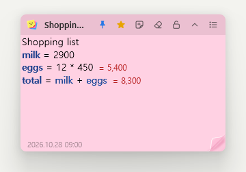
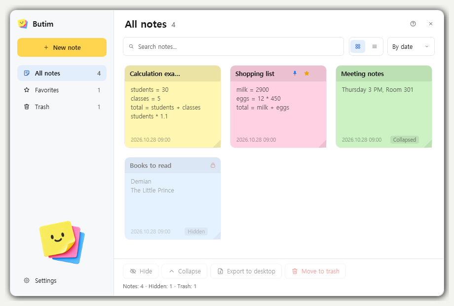
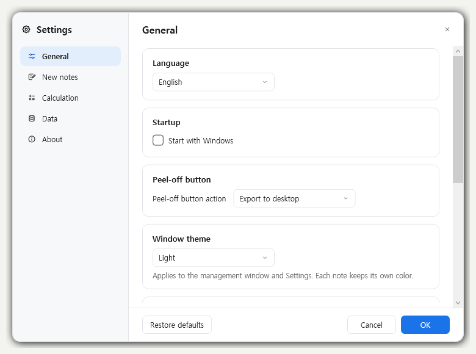

# Butim

**Sticky notes that calculate as you write.**

[한국어](README.ko.md) · [Download](https://github.com/funk80/Butim/releases/latest) · [User guide](docs/en/user-guide.md) · [Technical reference](docs/en/technical-reference.md)

Butim is a Windows sticky notes app for tasks, meeting notes, and quick calculations. Each note has its own window with colors, fonts, pinning, editing lock, and collapse controls. Export a note as a `.butim` file and double-click it to bring it back.

**Windows 10/11 (x64) · English & Korean · Free for personal and business use**



## Download and install

1. Open the [latest release](https://github.com/funk80/Butim/releases/latest).
2. Under **Assets**, download **Butim_Setup.exe**.
3. Run the installer and follow the instructions.
4. Launch Butim and press **Ctrl+Alt+N** to create a note.

If .NET 10.0 Desktop Runtime (x64) is missing, the bundled runtime installer installs it. Butim installs for the current user; runtime installation may require administrator approval. The app stays in the system tray and creates a usage note on first launch.

## Features

| Feature | What you can do |
| --- | --- |
| Inline calculations | Use variables, arithmetic, parentheses, powers, and percentages. Results appear at the end of each line. |
| Custom notes | Choose eight colors and fonts; retain each note's size and position. |
| Window controls | Keep notes on top, lock editing, collapse to the title bar, or hide them. |
| Snap alignment | Align with other notes or work-area edges; hold `Alt` to bypass snapping. |
| Note management | Search, favorite, sort, use grid/list views, and act on multiple notes. |
| File export | Move a note to a desktop `.butim` file and import it by double-clicking. |
| Trash | Restore notes before permanently deleting them. |
| Languages and themes | English/Korean; light, dark, or system themes for management and settings windows. |
| Automatic saving | Notes save after a short pause in typing and reopen in their saved positions. |

### Calculate in a note

```text
price = 12000
quantity = 5
total = price * quantity
discounted = total * (1 - 10%)
```

The last two lines display **60,000** and **54,000**. Type only the expressions; Butim supplies the results. Dates and Korean phone-number formats are excluded by default; custom exclusions can be added with the pattern helper.

### Manage your notes



### Make it yours



This screenshot is from a test instance with startup disabled. Start with Windows is enabled by default in normal use.

## Shortcuts

| Shortcut | Action |
| --- | --- |
| `Ctrl+Alt+N` | New note |
| `Ctrl+Alt+M` | Bring all notes to the front |
| `Ctrl` + mouse wheel, or `Ctrl` + `+` / `-` | Adjust font size while editing |
| `Ctrl+0` | Restore the default font and size |
| `Alt` + drag | Bypass snapping |

The first two shortcuts are global and can be changed in settings.

## Documentation

Documentation describes **v1.9.2**. The release page identifies the downloadable version.

- [User guide](docs/en/user-guide.md): note controls, calculation rules, exclusions, management, settings, data, and troubleshooting.
- [Technical reference](docs/en/technical-reference.md): architecture, storage formats, implementation, and build requirements.
- [Documentation layout and image sources](docs/README.md): language organization and future source-code placement.
- [한국어 설명](README.ko.md) · [한국어 사용 설명서](docs/ko/user-guide.md)

## License

Free for individuals, businesses, and organizations, including for work. Internal deployment and backup copies are permitted.

Butim is proprietary software. This repository currently provides documentation and release assets, not application source. Modification, external redistribution, sale, rental, or bundling requires prior permission except where applicable law or a component's separate license permits otherwise. Sharing the official download link is welcome.

See [LICENSE.txt](LICENSE.txt) for the full terms in Korean. Third-party components retain their own licenses.
