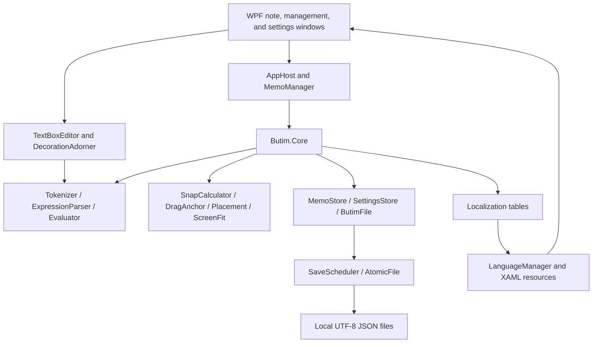
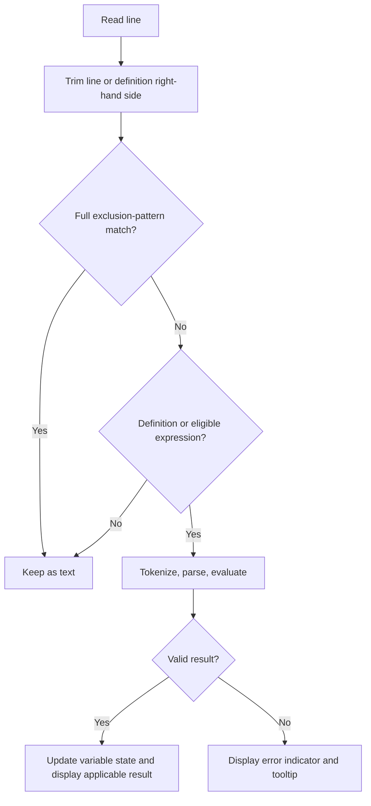

# Technical reference

[Overview](../../README.md) · [User guide](user-guide.md) · [한국어](../ko/technical-reference.md)

This reference describes **v1.9.2** from the project's development documentation. **The current checkout contains documentation, not source code.** Source paths and build commands below describe the development tree and require that tree to be supplied. They are not runnable instructions for this checkout, and documenting the architecture does not change the [license](../../LICENSE.txt).

## Architecture

The application separates WPF UI concerns from calculation, layout, storage, and language logic in a WPF-independent core.



This diagram summarizes the documented responsibilities; it is not a source-level dependency audit.

### Development source layout

These directories are **not currently included**. Keep documentation in `docs/` if source is later added, so documentation screenshots are not confused with runtime assets.

```text
Butim.sln
src/
  Butim.Core/                 # No WPF dependency
    Calc/                    # Tokenizer, ExpressionParser, Evaluator, Calculator,
                             # ExclusionPattern, PatternBuilder, NumberFormatter
    Input/Hotkey.cs          # Shortcut parsing and display
    Layout/                  # SnapCalculator, DragAnchor, Placement, ScreenFit
    Localization/            # AppLanguage, L, Strings.*.cs
    Model/                   # Memo, AppSettings, MemoColor, CloseAction, MenuItemKeys
    Storage/                 # MemoStore, SettingsStore, ButimFile,
                             # AtomicFile, SaveScheduler
  Butim/                     # WPF application
    App/                     # AppHost, MemoManager, TrayIcon, HotkeyService,
                             # SingleInstance, AutoStart
    Editor/                  # TextBoxEditor, DecorationAdorner
    Windows/                 # MemoWindow, ManagementWindow, SettingsWindow,
                             # PatternHelperWindow, FontWindow, CurlCorner
    Themes/                  # Light, Dark, Controls, Icons, LanguageManager
    Assets/                  # Runtime help.html/help and help-en.html/help-en
tests/Butim.Tests/           # xUnit
tools/Convert-Spn.ps1        # StickyPad .spn to .butim conversion
Installer/                  # setup.iss, build-installer.ps1, fetch-runtimes.ps1
```

## Editor and calculation engine

Notes use a WPF `TextBox`, with `DecorationAdorner` drawing results and colored decorations over it. The development documentation records the following comparison with a considered WebView2 implementation:

| Approach | One note | Twenty notes |
| --- | --- | --- |
| TextBox + Adorner | About 1.3 MB | About 147 MB |
| WebView2 | About 35 MB | About 940 MB |

These are reported development measurements, not independently reproduced benchmarks; the original comparison does not specify a full measurement procedure.

`Butim.Core.Calc` processes lines through `Tokenizer → ExpressionParser → Evaluator`. Decimal arithmetic makes `0.1 + 0.2` equal `0.3`. The engine lives outside WPF and is unit-testable. Its exclusion check matches the entire trimmed line, or the right side of a definition, against enabled built-in and custom patterns before calculation.



The flow is a conceptual summary; the [user guide](user-guide.md#calculations) explains plain-label and undefined-name cases.

## Window behavior

- Notes use borderless `WindowChrome` windows without `AllowsTransparency`. Since v1.8.5, Windows supplies shadows and rounded corners. Windows 11 clips the square note surface, and `DwmSetWindowAttribute` removes the 1-pixel perimeter line. The curled corner is overlaid artwork. The older transparent-window approach included shadow space that displaced notes at the top screen edge.
- Since v1.8.6, `WS_EX_TOOLWINDOW` is applied to WPF's hidden owner window rather than the note itself. This hides taskbar/Alt+Tab entries while retaining Windows' correction when a note is dragged beneath the taskbar.
- Snapping adjusts the rectangle in `WM_MOVING`. Since v1.6.0, `DragAnchor` records the cursor-to-window offset at the first message and reconstructs the unsnapped position from cursor minus offset before applying snapping, preventing accumulated drift.
- Since v1.8.4, `WS_MAXIMIZEBOX` is removed. Otherwise Windows maximization/snap layout changes can bypass `WM_SIZING` and save a screen-sized note.
- Icons use a 24×24 line grid with 1.8 stroke width and rounded ends. The app logo selects a suitable image from its `.ico` for display scaling.

## Localization

`Butim.Core.Localization` contains `Strings.*.cs` tables pairing Korean and English strings. Code uses `L.Get("key")`; XAML uses `{DynamicResource S.key}`. `LanguageManager` replaces resource strings to update already-open windows.

`SourceGuardTests` detects new Korean literals outside the designated tables and references to missing localization keys in XAML. Selecting a language previews it immediately; OK saves it and Cancel restores the previous value. If `language` is absent, `L.Resolve` uses the Windows display language: Korean for Korean Windows, English otherwise. English opens `help-en.html`; Korean opens `help.html`.

## Single instance and persistence

A named mutex, `Local\Butim.SingleInstance`, prevents duplicate normal instances. When another process opens a `.butim` file, it forwards the path through the current-user-only named pipe `Butim.<SID>` and exits. `Butim.exe --exit` requests a normal shutdown.

After 0.5 seconds without typing, saving writes a temporary `.tmp` file and then replaces the destination. Export removes the note from the app store only after the `.butim` write succeeds, retaining the original if export fails.

## Storage format

The base directory is `%APPDATA%\Butim\`. Settings and notes use UTF-8 JSON; one note occupies one file.

| Relative path | Purpose |
| --- | --- |
| `settings.json` | App settings |
| `memos/<id>.json` | Active and hidden notes |
| `trash/<id>.json` | Trashed notes |
| `logs/butim.log` | Errors/export events; above 1 MB it rotates to `butim.old.log` |

### Note JSON

Keys use camelCase; absent optional values such as a per-note `fontFamily` are omitted. The title is the first line of `text`, not a separate field. The following illustrative export includes the required `"format": "butim"` marker; internal note JSON uses the same structure without that marker. Import rejects a `.butim` file without it. The ID below is an example.

```json
{
  "format": "butim",
  "schemaVersion": 1,
  "id": "3f2a0000-0000-4000-8000-000000000001",
  "contentType": "text/plain",
  "text": "Meeting preparation\nstudents = 30",
  "color": "yellow",
  "bounds": { "x": 1200, "y": 300, "width": 240, "height": 220 },
  "collapsed": false,
  "topmost": false,
  "hidden": false,
  "favorite": true,
  "locked": false,
  "createdAt": "2026-10-27T09:00:00+09:00",
  "modifiedAt": "2026-10-27T09:12:30+09:00"
}
```

### Settings JSON

This example explicitly selects English. `language` is not initially written until Settings is confirmed. `managementWindowBounds` appears after the management window is first closed. With `randomColor` on, `defaultColor` is retained for use when random colors are disabled.

```json
{
  "autoStart": true,
  "hotkeyNewMemo": "Ctrl+Alt+N",
  "hotkeyBringAll": "Ctrl+Alt+M",
  "defaultColor": "yellow",
  "randomColor": true,
  "defaultFontFamily": "Malgun Gothic",
  "defaultFontSize": 8,
  "theme": "light",
  "language": "english",
  "listView": "grid",
  "listSort": "modified",
  "firstRunDone": true,
  "disabledDefaultPatterns": [],
  "userPatterns": [],
  "closeButtonAction": "export",
  "hiddenCaptionIcons": []
}
```

### Older settings

| Existing version | Interpretation |
| --- | --- |
| 1.5 and earlier | Missing `closeButtonAction` defaults to desktop export. |
| 1.6 | `hiddenMenuItems` is unused from 1.7.0 onward; missing `hiddenCaptionIcons` shows all title-bar icons. |
| 1.8 and earlier | Missing `language` follows the Windows display language. |

## Build reference — requires source

The following requirements and commands come from the development documentation. Source, solution files, tests, and installer scripts are **not included in the current repository**, so builds were not run for this documentation update.

| Dependency | Documented requirement |
| --- | --- |
| SDK | .NET 10.0 SDK |
| IDE/CLI | Visual Studio supporting .NET 10, or `dotnet` CLI |
| NuGet | `H.NotifyIcon.Wpf 2.3.2`, restored automatically |
| Installer compiler | Inno Setup 6; the build script looks specifically for `%LOCALAPPDATA%\Programs\Inno Setup 6\ISCC.exe` |

Run from the development checkout after the source is available:

```powershell
dotnet build Butim.sln -c Release
dotnet test tests/Butim.Tests
```

The tests cover core calculation, layout, storage, and localization guards. To release file locks before a build, use the app's normal shutdown command:

```powershell
Butim.exe --exit
```

### Separate test or screenshot data

```powershell
Butim.exe --data D:\ButimTest
```

Use the executable's actual path if it is not on PATH. A `--data` instance stores settings and notes in that folder and uses a distinct single-instance name, allowing it to coexist with normal use. It does not register global shortcuts or startup. Missing/unresolvable folder arguments exit without a window; a valid missing directory is created. **Desktop export still writes to the real desktop.**

### Installer build and versioning

```powershell
pwsh Installer/build-installer.ps1
```

The script publishes with ReadyToRun, obtains the .NET Desktop Runtime installer, compiles Inno Setup, and produces `Output/Butim_Setup.exe`. The version is defined only in `src/Butim/Butim.csproj` under `<Version>`; the installer reads it.

Each build records the version and source-tree hash in `Installer/build-history.tsv`. The script rejects the same version built from different sources and rejects uncommitted changes in `src/`, `Installer/setup.iss`, `Installer/build-installer.ps1`, or `Installer/fetch-runtimes.ps1`.

The installer is framework-dependent (`exe`, `dll`, `deps.json`, and `runtimeconfig.json`) with ReadyToRun. It installs per user under `%LOCALAPPDATA%\Programs\Butim`, registers `.butim` in HKCU, and retains `%APPDATA%\Butim` on uninstall. Startup registration is removed only when it points to the installation being removed.

## When source is added later

Keep source in `src/`, tests in `tests/`, development tools in `tools/`, and installer scripts in `Installer/`. Keep screenshots and public guides under `docs/`; runtime assets stay in `src/Butim/Assets/`. Publish installer binaries through GitHub Releases rather than alongside source. Update statements about source availability only when the source is actually present, and retain the intended license terms.
