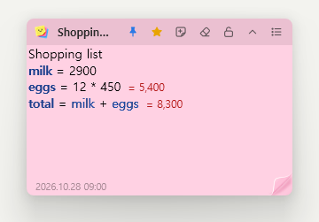
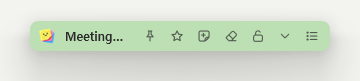
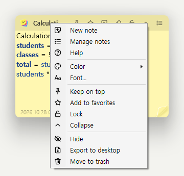
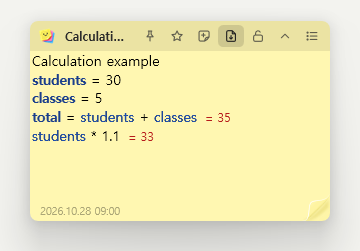
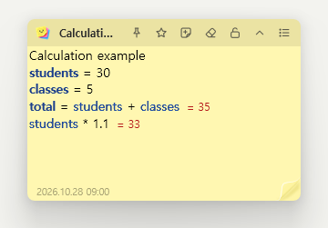
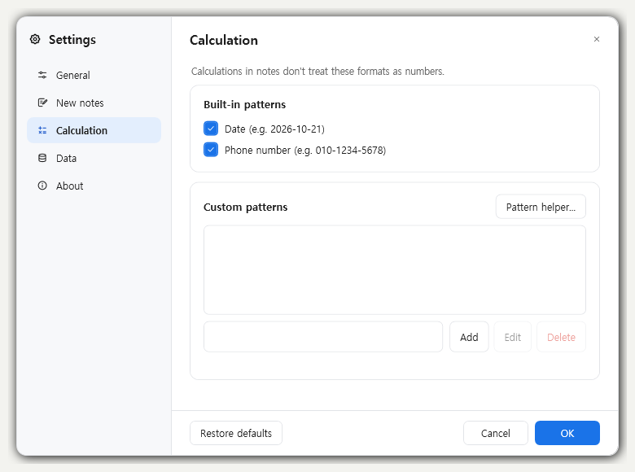
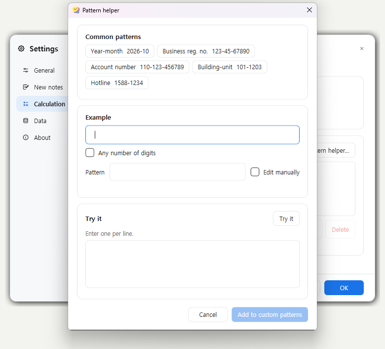
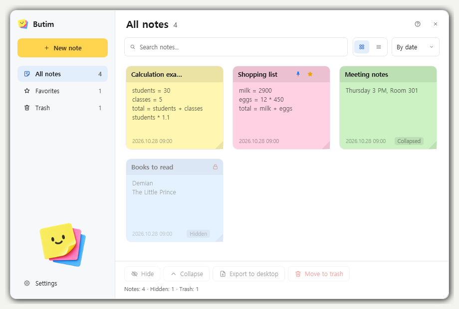
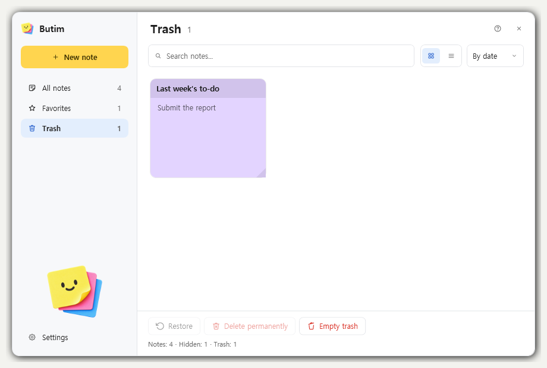
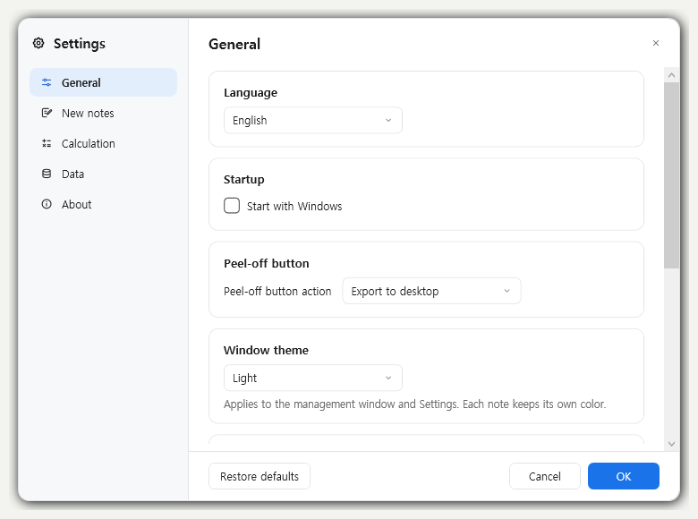

# Butim user guide

[Overview](../../README.md) · [한국어](../ko/user-guide.md) · [Technical reference](technical-reference.md)

Based on Butim **v1.9.2**. All screenshots on this page show the English interface.

## Contents

- [Getting started](#getting-started)
- [Note window](#note-window)
- [Moving and resizing](#moving-and-resizing)
- [Peel off and export](#peel-off-and-export)
- [Calculations](#calculations)
- [Formats not to calculate](#formats-not-to-calculate)
- [Manage notes](#manage-notes)
- [Settings](#settings)
- [Shortcuts](#shortcuts)
- [Data and installation](#data-and-installation)
- [Troubleshooting](#troubleshooting)

## Getting started

Download `Butim_Setup.exe` from the [latest release](https://github.com/funk80/Butim/releases/latest) and follow the installer. Windows 10/11 x64 is supported. The installer includes .NET 10.0 Desktop Runtime (x64) and installs it if needed. Runtime installation may ask for administrator approval; the app itself installs for the current user.

Leave the launch option checked at the end of setup to start Butim. A usage note is created on first launch. The app stays in the taskbar notification area (system tray).

Create a note with `Ctrl+Alt+N`, the title-bar New note button, the note menu, the tray menu, or the management window. The first line becomes the title. Notes created from global shortcuts, the tray, or management fill free space from the top left; when no free space remains, they are placed with a staggered overlap. A note created from another note opens beside it, or below when needed.

Typing is saved automatically after a 0.5-second pause. Each note remembers its color, font, size, position, and state. Click the tray icon or press `Ctrl+Alt+M` to bring notes forward. The tray menu also provides Manage notes, Help, and Exit, and displays the current shortcuts.

## Note window



The title bar contains the logo/menu, title, and action buttons. The body accepts plain text and expressions; calculated results appear in small red text at the end of a line. A curled-corner illustration sits at the bottom right.

| Button | Behavior |
| --- | --- |
| Logo/menu | Open the note menu; right-clicking the title bar opens it too. |
| Always on top | Keep the note above other windows. The pin is blue while enabled. |
| Favorite | Add the note to Favorites. The star is yellow while enabled. |
| New note | Create a neighboring note. |
| Peel off | Export, hide, or move to trash according to Settings. Hover to see the selected action's icon and tooltip. |
| Lock | Prevent text editing. The lock is red while enabled. Moving, recoloring, and deleting remain possible. |
| Collapse | Leave only the title bar. Double-clicking the title bar also toggles collapse. |
| Manage notes | Open the management window. |

All icons except the logo can be hidden under **Settings → General → Title bar icons**. Their functions remain available in the menu. Fewer icons let you make the note narrower.



### Note menu and appearance



The menu contains New note, Manage notes, Help, Color, Font, Always on top, Favorite, Lock, Collapse, Hide, Export to desktop, and Move to trash. Menu wording describes the next action, such as turning Always on top off when it is already enabled. Hiding title-bar icons does not hide menu items.

Eight colors are available: yellow, green, blue, pink, purple, orange, gray, and white. Set a font for an individual note or use the default font in Settings. While editing, `Ctrl` + mouse wheel or `Ctrl` + `+` / `-` changes the size by 1 pt; `Ctrl+0` restores the default font and size.

## Moving and resizing

Drag the title bar to move and the window edge to resize. Notes snap when they come within 10 DIP of another note or the work-area boundary (the screen excluding the taskbar). At 100% scaling, 10 DIP is 10 pixels. Hold `Alt` while dragging to bypass snapping.

Resizing uses 10-DIP increments. Minimum height is 100 DIP. Minimum width is `110 + visible icon count × 27`: 299 DIP with all seven action icons, or 110 with none. Changing visible icons adjusts notes that are at or below the new minimum width. Notes outside the available screen area are brought back on screen at startup.

## Peel off and export

| Selected action | Result |
| --- | --- |
| Export to desktop (default) | Write a `.butim` file to the desktop and close the note window. |
| Hide | Keep the note in the app but hide its window. Use Show in management to bring it back. |
| Move to trash | Put the note in the app's trash, where it can be restored. |

| Export | Hide | Trash |
| --- | --- | --- |
|  |  |  |

An empty or whitespace-only note is deleted immediately when exported or moved to trash. Hide retains even an empty note.

Export uses the first line as the filename, removes invalid filename characters, and limits the title portion to 40 characters. An empty first line uses a generated timestamped name. A duplicate name receives a suffix such as ` (2)`. The saved filename briefly appears in a tray notification. If writing fails, the original note remains.

Double-click a `.butim` file to import it. You can also select a file under **Settings → Data**. **Successfully imported files are deleted** as the note returns to the app. Keep a separate copy first if you need to preserve an exported file as an archive.

## Calculations



There is no separate Calculate command. Butim interprets each line independently, using variables defined above it.

| Line type | Example | Behavior |
| --- | --- | --- |
| Definition | `students = 30`, `perClass = students / classes` | Define a name. Display the result unless the right side is just one number, including a negative number. |
| Standalone expression | `students * 2`, `3 + 4` | Show a result when an operator is present and every referenced name is defined. |
| Plain text | `London - Paris`, `title = Minutes` | Leave ordinary text unchanged. |

Type:

```text
students = 30
classes = 5
perClass = students / classes
total = teachers + 1
```

`perClass` displays **6**. The last line displays a gray `?` because `teachers` has not been defined. The result and error indicator are generated by the app, not part of the text you type.

### Rules and feedback

- Operators: `+ - * / ^ ( )`, unary minus, and postfix `%`. `20%` means `0.2`.
- Numbers use decimal arithmetic; `0.1 + 0.2` evaluates to `0.3`.
- Numeric grouping commas must separate groups of three digits, as in `1,000`. Results use thousands separators and at most ten fractional digits.
- Names are case-sensitive. Letters A–Z/a–z, Hangul syllables, digits, and `_` are allowed, but a name cannot begin with a digit.
- A redefinition takes effect on following lines. A standalone expression with an undefined name remains text. A definition expression with an undefined name displays `?`; a plain label assignment such as `title = Minutes` remains text.
- Defined names are emphasized, variables are blue, undefined names receive a brown wavy underline, and calculation errors have a gray `?` with a tooltip.
- Tooltips explain problems such as division by zero, an excessively large value, an undefined variable, a variable whose value could not be calculated, or a value that cannot be calculated.

## Formats not to calculate

A full line, or the right side of `=`, is not calculated if its trimmed text fully matches an enabled exclusion pattern.

| Built-in pattern | Regular expression | Default |
| --- | --- | --- |
| Year-first date | `\d{4}[-./]\d{1,2}[-./]\d{1,2}` | On |
| Korean phone number | `0\d{1,2}-\d{3,4}-\d{4}` | On |

These formats stay the same in the English UI. For example, `2026-10-27` and `010-1234-5678` are excluded, but `10/28/2026`, `555-123-4567`, and `2026-10` need additional patterns if you want them kept as text.



Open **Settings → Calculation → Pattern helper...** to build exclusions without writing regular expressions:

1. Enter an example such as `101-1203`; the helper generates a pattern such as `\d{3}-\d{4}`.
2. Enable **Any number of digits** if digit counts should vary, or edit the pattern manually.
3. Enter sample lines in **Try it** to see whether each is calculated.
4. Choose **Add to custom patterns** to add the result.

Common examples include Year-month, Business reg. no., Account number, Building-unit, and Hotline. You can also enter a pattern directly in Calculation settings and select Add. Built-in date and phone patterns can be disabled individually.



## Manage notes

Open Manage notes from a note's title bar, its menu, or the tray menu.



| Area | Function |
| --- | --- |
| Left sidebar | New note, All notes, Favorites, Trash, and Settings. |
| Heading | Current list name and note count; search shows the number of results. |
| Top controls | Content search, grid/list view, and sort by modification date, creation date, name, or color. |
| Note cards | First-line title and content preview: four lines in grid view, one in list view. Toggle Always on top, Favorite, and Lock. Hidden cards are faded; hidden/collapsed states are labeled. |
| Bottom actions | Show/Hide, Expand/Collapse, Export to desktop, Move to trash. Trash provides Restore, Delete permanently, and Empty trash. |
| Status bar | Total, hidden, and trashed note counts. |

Select several notes to apply actions together. Double-click a note to bring it forward and start typing; hidden notes are shown. Selecting a visible note gives its window a blue border and raises it below the management window without taking focus away from management. The highlight disappears when selection changes or management closes. Hidden notes are marked only in the list.

Show/Hide and Expand/Collapse share toggle positions. With a mixed selection, Show or Expand appears with a gray background and applies to all selected notes. Since v1.8.0 there are at most four bottom action buttons, fitting the minimum 780-DIP window width. Permanent deletion and Empty trash have distinct icons.



## Settings

Open Settings at the bottom left of the management window.



| Tab | Options and defaults |
| --- | --- |
| General | Language, Start with Windows (on), peel-off action (export), window theme (light), global shortcuts, and visible title-bar icons (all). |
| New notes | Random color by default; default font and size for notes without a per-note font, with a preview. |
| Calculation | Enabled built-in exclusions, custom patterns, and the pattern helper. |
| Data | Open the storage folder and import `.butim` files. Imported files are deleted. |
| About | App information, version, copyright, and Help. |

The screenshot is from a test instance with Start with Windows off; normal startup defaults to on.

### Language and theme

On first use, Korean Windows selects Korean; other Windows display languages select English. Choosing a language updates open windows immediately, but **OK** saves the choice and **Cancel** restores the previous language. Help follows the selected language. Restore defaults returns language selection to the Windows-based default and does not erase custom exclusion patterns.

Window themes are Light, Dark, or Follow system. They apply to management and settings; individual notes keep their own colors.

### Change a shortcut

Click the shortcut input and press the desired combination. Use at least one of `Ctrl`, `Alt`, `Shift`, or `Win` plus A–Z, 0–9, or F1–F12. Existing global shortcuts pause while the field has focus, allowing you to enter an existing combination. Press `Esc`, or leave without completing a combination, to restore the previous value. A conflict with another app is shown beside the field and in a startup notification.

## Shortcuts

| Shortcut | Action |
| --- | --- |
| `Ctrl+Alt+N` | New note, globally |
| `Ctrl+Alt+M` | Bring all notes forward, globally |
| `Alt` + drag | Bypass snapping |
| `Ctrl` + wheel or `Ctrl` + `+` / `-` | Change text size by 1 pt |
| `Ctrl+0` | Restore default font and size |

Help is available from the note menu, tray menu, the management window's `?`, or Settings → About.

## Data and installation

| Location | Contents |
| --- | --- |
| `%LOCALAPPDATA%\Programs\Butim` | Installed application |
| `%APPDATA%\Butim\settings.json` | Settings |
| `%APPDATA%\Butim\memos\<id>.json` | One UTF-8 JSON file per note, including hidden notes |
| `%APPDATA%\Butim\trash\<id>.json` | Trashed notes |
| `%APPDATA%\Butim\logs\butim.log` | Error/export log; rotated to `butim.old.log` above 1 MB |

The installer registers `.butim` files for the current user. Uninstalling removes the app and file association, and removes the startup entry only if it points to that installation. **Note data is retained**, so reinstalling lets you continue with it. Exported `.butim` files are separate from the app's live storage. See the [technical reference](technical-reference.md) for JSON fields and migration behavior.

## Troubleshooting

| Problem | Explanation and action |
| --- | --- |
| Global shortcut does nothing | Another app may have registered it first. Choose a different shortcut in General settings. |
| `2026-10` is calculated | The built-in date pattern requires year, month, and day. Add Year-month with the pattern helper. |
| A note is missing | For a hidden note, use Show in management; for one behind other windows, use Bring all to front. Off-screen notes are repositioned at startup. |
| Peel off made a note disappear | Its default action exports to the desktop. Double-click the `.butim` file, or change the peel-off action in General settings. |
| A locked note can be moved or deleted | Lock protects text editing only; this behavior is intentional. |
| Need to migrate StickyPad notes | The documented development tool `tools/Convert-Spn.ps1` converts `.spn` to `.butim`. That tool is not included in this documentation-only checkout. If supplied separately, convert and double-click the result. |

For the usage terms, see [LICENSE.txt](../../LICENSE.txt). For technical/build details, see the [technical reference](technical-reference.md).
