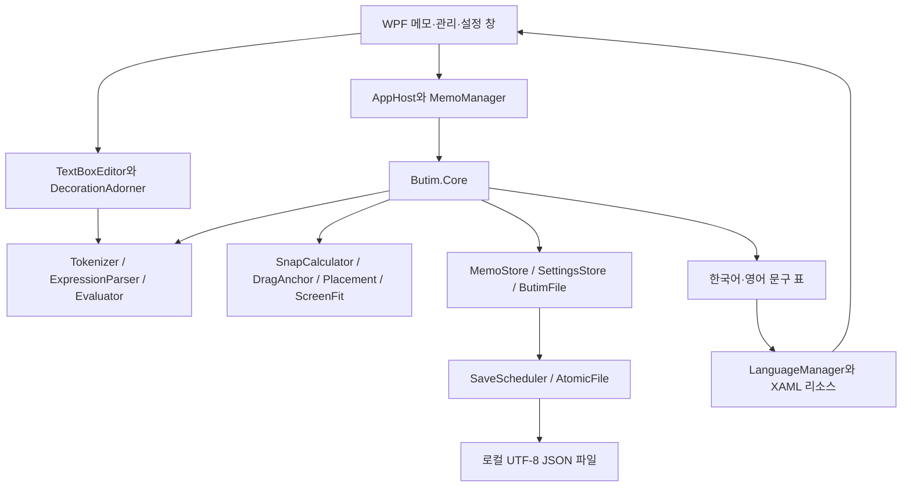
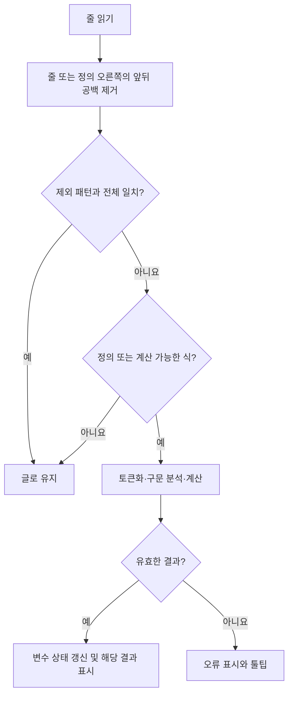

# 기술 참고 문서

[소개](../../README.ko.md) · [사용 설명서](user-guide.md) · [English](../en/technical-reference.md)

개발 문서에 기재된 **v1.9.2** 기준입니다. **현재 체크아웃에는 문서만 있고 소스 코드는 없습니다.** 아래 소스 경로와 빌드 명령은 개발 트리의 설명이며, 해당 소스를 별도로 갖춘 경우에만 사용할 수 있습니다. 아키텍처 설명을 공개하는 것이 [라이선스](../../LICENSE.txt)를 바꾸지는 않습니다.

## 아키텍처

WPF 화면과 계산·배치·저장·언어 로직을 분리합니다. `Butim.Core`는 WPF를 참조하지 않습니다.



문서에 설명된 역할을 요약한 구성도이며 소스 수준의 의존성 분석 결과는 아닙니다.

### 개발 소스 구조

아래 디렉터리는 **현재 포함되어 있지 않습니다**. 나중에 추가하더라도 공개 문서는 `docs/`에 유지하여 문서용 캡처와 실행 자산이 섞이지 않게 합니다.

```text
Butim.sln
src/
  Butim.Core/                 # WPF 비참조
    Calc/                    # Tokenizer, ExpressionParser, Evaluator, Calculator,
                             # ExclusionPattern, PatternBuilder, NumberFormatter
    Input/Hotkey.cs          # 단축키 파싱·표시
    Layout/                  # SnapCalculator, DragAnchor, Placement, ScreenFit
    Localization/            # AppLanguage, L, Strings.*.cs
    Model/                   # Memo, AppSettings, MemoColor, CloseAction, MenuItemKeys
    Storage/                 # MemoStore, SettingsStore, ButimFile,
                             # AtomicFile, SaveScheduler
  Butim/                     # WPF 앱
    App/                     # AppHost, MemoManager, TrayIcon, HotkeyService,
                             # SingleInstance, AutoStart
    Editor/                  # TextBoxEditor, DecorationAdorner
    Windows/                 # MemoWindow, ManagementWindow, SettingsWindow,
                             # PatternHelperWindow, FontWindow, CurlCorner
    Themes/                  # Light, Dark, Controls, Icons, LanguageManager
    Assets/                  # 실행 시 도움말 help.html/help, help-en.html/help-en
tests/Butim.Tests/           # xUnit
tools/Convert-Spn.ps1        # StickyPad .spn → .butim
Installer/                  # setup.iss, build-installer.ps1, fetch-runtimes.ps1
```

## 편집기와 계산 엔진

WPF `TextBox` 위에 `DecorationAdorner`로 계산 결과와 색 표시를 덧그립니다. 개발 문서에서는 검토했던 WebView2 방식과 다음과 같이 비교합니다.

| 방식 | 메모 1개 | 메모 20개 |
| --- | --- | --- |
| TextBox + Adorner | 약 1.3MB | 약 147MB |
| WebView2 | 약 35MB | 약 940MB |

개발 문서에 기록된 측정값이며 이번 문서 작업에서 다시 측정한 벤치마크는 아닙니다. 원문에는 상세 측정 절차가 기재되어 있지 않습니다.

`Butim.Core.Calc`의 `Tokenizer → ExpressionParser → Evaluator`가 줄 단위로 처리합니다. decimal을 사용해 `0.1 + 0.2`를 `0.3`으로 계산합니다. 엔진은 WPF와 분리되어 단위 테스트할 수 있습니다. 계산 전에 줄 전체 또는 정의 줄 오른쪽을 정리해 기본·사용자 제외 패턴과 전체 일치하는지 확인합니다.



개념을 요약한 흐름도입니다. 단순 글 대입과 미정의 이름의 처리는 [사용 설명서](user-guide.md#계산)를 참고하세요.

## 창 구현

- `WindowChrome` 기반의 테두리 없는 창이며 `AllowsTransparency`를 쓰지 않습니다. v1.8.5부터 그림자와 둥근 모서리는 Windows에 맡깁니다. Windows 11이 직각 면의 모서리를 잘라내며 `DwmSetWindowAttribute`로 둘레 1px 선을 없앱니다. 말린 모서리는 그림을 겹칩니다. 이전의 투명 창 방식은 그림자 여백 때문에 화면 위끝에서 메모가 내려가 보였습니다.
- v1.8.6부터 `WS_EX_TOOLWINDOW`는 메모 자체가 아닌 WPF의 숨은 owner window에 적용합니다. 작업 표시줄·Alt+Tab에서 숨기면서 작업 표시줄 아래로 옮겼을 때 Windows의 위치 보정을 유지합니다.
- 자석은 `WM_MOVING`의 사각형을 바꿉니다. 누적 오차를 피하려고 v1.6.0부터 `DragAnchor`가 첫 메시지에서 커서와 창의 간격을 기억하고, 이후 커서−간격으로 원래 위치를 만든 뒤 자석을 적용합니다.
- v1.8.4부터 `WS_MAXIMIZEBOX`를 뺍니다. Windows 최대화·스냅의 크기 변경이 `WM_SIZING`을 거치지 않아 메모가 화면 크기로 저장되던 문제를 막습니다.
- 아이콘은 24×24 격자의 굵기 1.8 선과 둥근 끝으로 구성합니다. 앱 로고는 배율에 맞는 `.ico` 이미지를 선택합니다.

## 다국어 처리

`Butim.Core.Localization`의 `Strings.*.cs`에 한국어·영어 문구를 짝지어 둡니다. 코드는 `L.Get("키")`, XAML은 `{DynamicResource S.키}`를 사용합니다. `LanguageManager`가 리소스 문구를 교체해 열린 창도 즉시 갱신합니다.

`SourceGuardTests`는 지정된 표 밖에 새 한글 리터럴이 들어오거나 XAML에서 없는 키를 참조하면 실패합니다. 언어 선택은 즉시 미리 적용하고 확인하면 저장, 취소하면 이전 값으로 복귀합니다. `language`가 없으면 `L.Resolve`가 Windows 표시 언어를 따릅니다. 한국어 Windows이면 한국어, 아니면 영어입니다. 도움말은 각각 `help.html`, `help-en.html`을 엽니다.

## 단일 실행과 저장

Named Mutex `Local\Butim.SingleInstance`로 일반 인스턴스의 중복 실행을 막습니다. 이미 실행 중일 때 `.butim` 파일을 열면 새 프로세스는 현재 사용자 전용 파이프 `Butim.<SID>`로 경로를 넘기고 종료합니다. `Butim.exe --exit`로 정상 종료를 요청합니다.

입력이 0.5초 멈추면 `.tmp` 파일에 쓴 뒤 원본을 교체합니다. 내보내기는 `.butim` 파일 쓰기를 성공한 뒤에만 앱 저장소에서 제거하므로 실패하면 원래 메모가 남습니다.

## 저장 형식

기본 위치는 `%APPDATA%\Butim\`입니다. 설정과 메모는 UTF-8 JSON이고 메모 하나가 파일 하나입니다.

| 상대 경로 | 용도 |
| --- | --- |
| `settings.json` | 앱 설정 |
| `memos/<id>.json` | 일반·숨김 메모 |
| `trash/<id>.json` | 휴지통 메모 |
| `logs/butim.log` | 오류·내보내기 기록. 1MB 초과 시 `butim.old.log`로 순환 |

### 메모 JSON

키는 camelCase이며 개별 `fontFamily`처럼 값이 없는 선택 필드는 생략합니다. 제목 필드는 따로 없고 `text` 첫 줄을 사용합니다. 아래는 내보낸 파일의 예로 필수 표시인 `"format": "butim"`을 포함합니다. 내부 메모 JSON은 이 표시를 제외하고 같은 구조입니다. `.butim`에 표시가 없으면 가져오기를 거부합니다. ID는 예시입니다.

```json
{
  "format": "butim",
  "schemaVersion": 1,
  "id": "3f2a0000-0000-4000-8000-000000000001",
  "contentType": "text/plain",
  "text": "회의 준비\n학생수 = 30",
  "color": "yellow",
  "bounds": { "x": 1200, "y": 300, "width": 240, "height": 220 },
  "collapsed": false,
  "topmost": false,
  "hidden": false,
  "favorite": true,
  "locked": false,
  "createdAt": "2026-10-27T09:00:00+09:00",
  "modifiedAt": "2026-10-27T09:12:30+09:00"
}
```

### 설정 JSON

아래 예는 한국어를 명시적으로 선택한 상태입니다. `language`는 설정에서 처음 확인할 때 기록하며, `managementWindowBounds`는 관리 창을 처음 닫을 때 생깁니다. `randomColor`가 켜져 있어도 `defaultColor`는 무작위를 끌 때 쓸 값으로 남습니다.

```json
{
  "autoStart": true,
  "hotkeyNewMemo": "Ctrl+Alt+N",
  "hotkeyBringAll": "Ctrl+Alt+M",
  "defaultColor": "yellow",
  "randomColor": true,
  "defaultFontFamily": "Malgun Gothic",
  "defaultFontSize": 8,
  "theme": "light",
  "language": "korean",
  "listView": "grid",
  "listSort": "modified",
  "firstRunDone": true,
  "disabledDefaultPatterns": [],
  "userPatterns": [],
  "closeButtonAction": "export",
  "hiddenCaptionIcons": []
}
```

### 이전 설정 호환

| 기존 버전 | 처리 |
| --- | --- |
| 1.5 이하 | 없는 `closeButtonAction`은 바탕화면 내보내기로 해석합니다. |
| 1.6 | `hiddenMenuItems`는 1.7.0부터 쓰지 않습니다. `hiddenCaptionIcons`가 없으면 아이콘을 모두 보입니다. |
| 1.8 이하 | `language`가 없으면 Windows 표시 언어를 따릅니다. |

## 빌드 참고 — 소스 필요

아래는 개발 문서의 요구사항과 명령입니다. **현재 저장소에는 소스·솔루션·테스트·설치 스크립트가 없으므로 이번 문서 수정에서 빌드를 실행하지 않았습니다.**

| 항목 | 요구사항 |
| --- | --- |
| SDK | .NET 10.0 SDK |
| IDE/CLI | .NET 10 지원 Visual Studio 또는 `dotnet` CLI |
| NuGet | `H.NotifyIcon.Wpf 2.3.2`, 자동 복원 |
| 설치기 컴파일러 | Inno Setup 6. 스크립트는 `%LOCALAPPDATA%\Programs\Inno Setup 6\ISCC.exe`만 찾습니다. |

소스가 있는 개발 체크아웃의 루트에서 실행합니다.

```powershell
dotnet build Butim.sln -c Release
dotnet test tests/Butim.Tests
```

테스트 대상은 코어 계산·배치·저장 및 다국어 가드입니다. 앱이 파일을 잠가 빌드를 막으면 정상 종료 명령을 사용합니다.

```powershell
Butim.exe --exit
```

### 시험·캡처 전용 데이터

```powershell
Butim.exe --data D:\ButimTest
```

PATH에 없으면 실행 파일의 실제 경로를 지정합니다. 별도 폴더에만 메모·설정을 저장하고 단일 실행 이름에 접미사를 붙여 일반 앱과 함께 실행할 수 있습니다. 전역 단축키와 자동 실행은 등록하지 않습니다. 폴더 인자가 없거나 해석할 수 없으면 창 없이 종료하고, 유효한 새 폴더는 만듭니다. **바탕화면 내보내기는 여전히 실제 바탕화면에 파일을 씁니다.**

### 설치기 빌드와 버전

```powershell
pwsh Installer/build-installer.ps1
```

ReadyToRun으로 publish → .NET Desktop Runtime 설치기 확보 → Inno Setup 컴파일 순서로 `Output/Butim_Setup.exe`를 만듭니다. 버전은 `src/Butim/Butim.csproj`의 `<Version>` 한 곳에서만 정하고 설치기가 읽습니다.

빌드마다 버전과 소스 트리 해시를 `Installer/build-history.tsv`에 기록합니다. 같은 버전을 다른 소스로 빌드하거나, `src/` 및 `Installer/setup.iss`, `Installer/build-installer.ps1`, `Installer/fetch-runtimes.ps1`에 커밋하지 않은 변경이 있으면 멈춥니다.

배포는 Framework-Dependent(`exe`, `dll`, `deps.json`, `runtimeconfig.json`)와 ReadyToRun 방식입니다. 사용자별 `%LOCALAPPDATA%\Programs\Butim`에 설치하고 HKCU에 `.butim` 연결을 등록하며, 제거해도 `%APPDATA%\Butim` 데이터는 남깁니다. 자동 실행 등록은 제거 대상 설치본을 가리킬 때만 지웁니다.

## 나중에 소스를 추가할 때

소스는 `src/`, 테스트는 `tests/`, 개발 도구는 `tools/`, 설치 스크립트는 `Installer/`에 둡니다. 공개 캡처·설명서는 `docs/`에 유지하고 앱 실행 자산은 `src/Butim/Assets/`에 둡니다. 설치 파일은 소스 옆에 커밋하지 않고 GitHub Releases로 배포합니다. 실제 소스가 추가된 뒤에만 소스 제공 여부 문구를 갱신하고, 의도한 라이선스 조건은 유지합니다.
