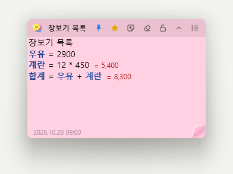
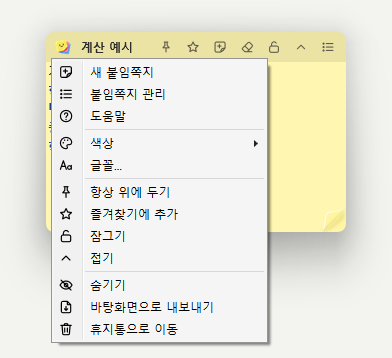
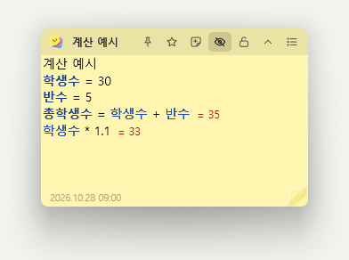
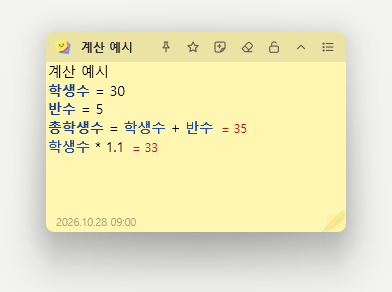
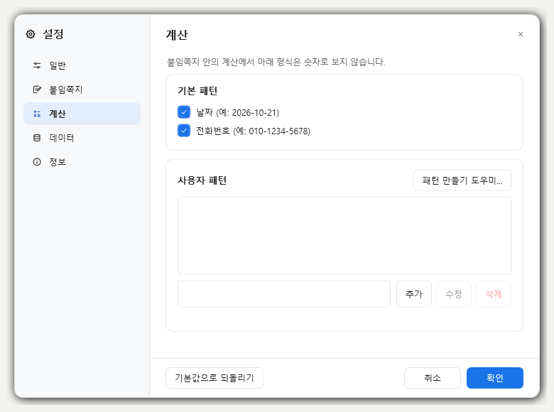
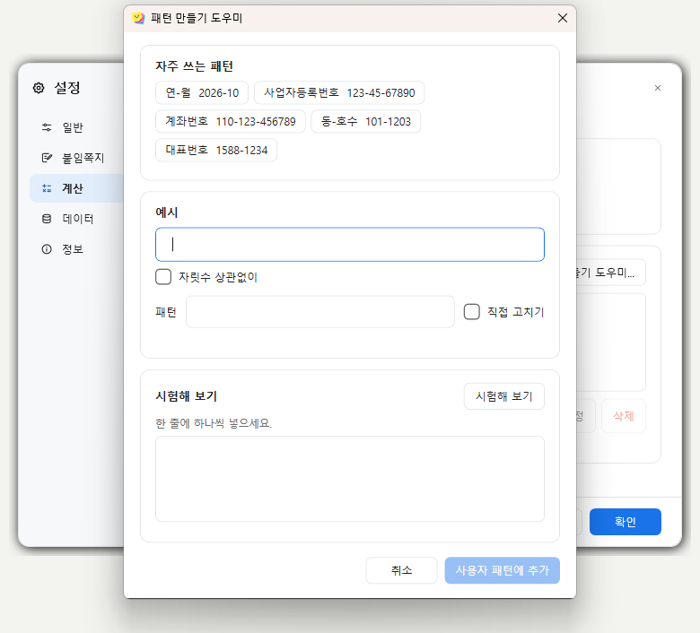
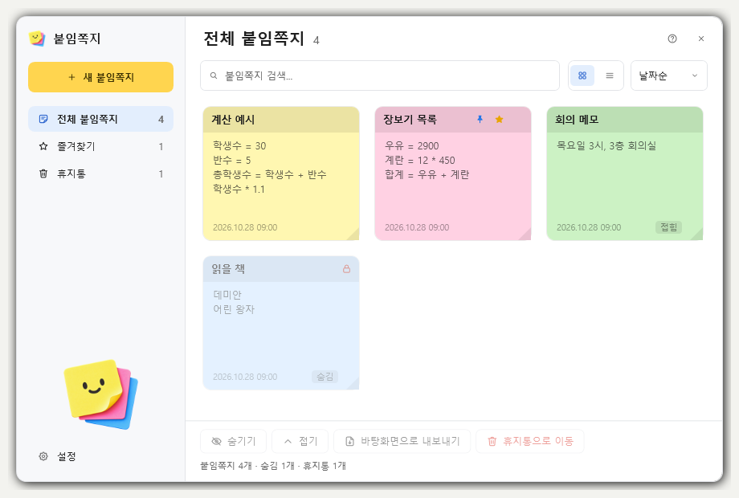
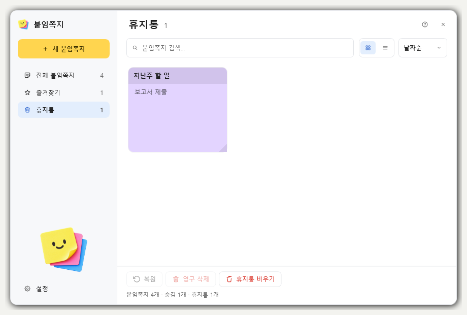
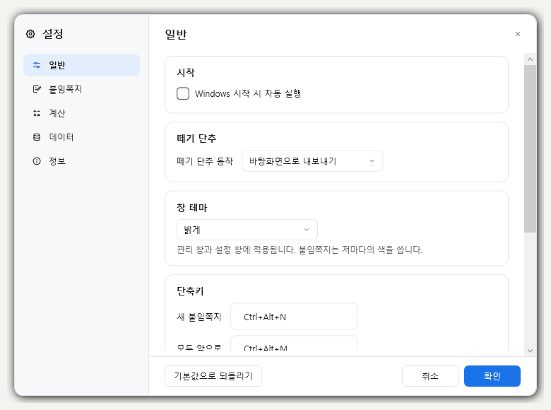

# 붙임쪽지(Butim) 사용 설명서 — 바탕화면 메모·계산·설정

[소개](../../README.ko.md) · [English](../en/user-guide.md) · [기술 참고 문서](technical-reference.md)

붙임쪽지 **v1.9.2** 기준입니다. 이 문서의 이미지는 모두 한국어 화면입니다.

붙임쪽지(Butim)는 수식과 변수를 계산하는 Windows 10/11 x64 바탕화면 메모 앱입니다. 이 설명서는 메모 작성과 정리, 메모 속 계산, 날짜·전화번호 계산 제외, `.butim` 파일 내보내기·가져오기, 언어·단축키 변경, 로컬 저장 위치를 다룹니다. 개인과 기업 모두 [자체 사용권 약관](../../LICENSE.txt)에 따라 무료로 사용할 수 있습니다.

## 목차

- [시작하기](#시작하기)
- [붙임쪽지 창](#붙임쪽지-창)
- [이동과 크기 조절](#이동과-크기-조절)
- [떼기와 내보내기](#떼기와-내보내기)
- [계산](#계산)
- [계산하지 않을 형식](#계산하지-않을-형식)
- [붙임쪽지 관리](#붙임쪽지-관리)
- [설정](#설정)
- [단축키](#단축키)
- [데이터와 설치](#데이터와-설치)
- [문제 해결](#문제-해결)

## 시작하기

[최신 릴리스](https://github.com/funk80/Butim/releases/latest)에서 `Butim_Setup.exe`를 내려받아 설치합니다. Windows 10/11 x64를 지원합니다. .NET 10.0 Desktop Runtime (x64)이 없으면 함께 포함된 설치기로 설치하며, 이때 관리자 권한 확인이 필요할 수 있습니다. 앱 자체는 사용자 단위로 설치됩니다.

설치 마지막 화면에서 붙임쪽지 실행을 켜 둔 채 마치면 앱이 열립니다. 처음 실행하면 사용법 붙임쪽지를 하나 만들고, 작업 표시줄 알림 영역에 상주합니다.

`Ctrl+Alt+N`, 제목줄의 새 붙임쪽지 단추, 붙임쪽지 메뉴, 알림 영역 메뉴, 관리 창에서 새 메모를 만듭니다. 본문의 첫 줄이 제목이 됩니다. 단축키·알림 영역·관리 창에서 만든 메모는 화면 왼쪽 위부터 빈자리에 맞닿게 배치하며, 자리가 없으면 비스듬히 겹칩니다. 기존 메모에서 만들면 옆에, 공간이 부족하면 아래에 엽니다.

입력을 0.5초 멈추면 자동 저장합니다. 메모마다 색상·글꼴·크기·위치·상태를 기억합니다. 알림 영역 아이콘을 누르거나 `Ctrl+Alt+M`을 누르면 모두 앞으로 가져옵니다. 알림 영역 메뉴에는 붙임쪽지 관리, 도움말, 종료도 있으며 현재 단축키가 표시됩니다.

## 붙임쪽지 창



제목줄에는 앱 로고 메뉴, 첫 줄에서 가져온 제목, 동작 단추가 있습니다. 본문에는 평범한 글과 수식을 함께 쓰며, 계산 결과는 줄 끝의 작은 빨간 글씨로 나타납니다. 오른쪽 아래에는 말린 모서리 그림이 표시됩니다.

| 단추 | 동작 |
| --- | --- |
| 로고/메뉴 | 붙임쪽지 메뉴를 엽니다. 제목줄 우클릭으로도 열 수 있습니다. |
| 항상 위 | 다른 창 위에 고정합니다. 켜지면 압정이 파란색입니다. |
| 즐겨찾기 | 관리 창의 즐겨찾기에 모읍니다. 켜지면 별이 노란색입니다. |
| 새 붙임쪽지 | 현재 메모 옆에 새 메모를 만듭니다. |
| 떼기 | 설정에 따라 내보내기·숨기기·휴지통 이동을 합니다. 마우스를 올리면 해당 동작 아이콘과 툴팁을 표시합니다. |
| 잠금 | 본문 편집을 막습니다. 켜지면 빨간색이며 이동·색 변경·삭제는 막지 않습니다. |
| 접기 | 제목줄만 남깁니다. 제목줄을 두 번 눌러도 접거나 펼칩니다. |
| 붙임쪽지 관리 | 관리 창을 엽니다. |

로고를 제외한 아이콘은 **설정 → 일반 → 제목줄에 보일 아이콘**에서 숨길 수 있습니다. 기능은 메뉴에 그대로 남고, 아이콘이 적을수록 메모 폭을 더 좁힐 수 있습니다.


### 메뉴와 꾸미기



메뉴에는 새 붙임쪽지, 붙임쪽지 관리, 도움말, 색상, 글꼴, 항상 위, 즐겨찾기, 잠금, 접기, 숨기기, 바탕화면으로 내보내기, 휴지통으로 이동이 있습니다. 아이콘은 현재 상태를, 문구는 누르면 할 동작을 나타냅니다. 예를 들어 항상 위가 켜져 있으면 해제하는 문구가 보입니다. 제목줄 아이콘을 숨겨도 메뉴 항목은 유지합니다.

색상은 노랑·초록·파랑·분홍·보라·주황·회색·흰색 8가지입니다. 메모별 글꼴을 정하거나 설정의 기본 글꼴을 따르게 할 수 있습니다. 본문에서 `Ctrl`+휠 또는 `Ctrl`+`+`/`-`로 1pt씩 바꾸고, `Ctrl+0`으로 기본 글꼴과 크기로 돌아갑니다.

## 이동과 크기 조절

제목줄을 끌어 이동하고 창 가장자리를 끌어 크기를 바꿉니다. 다른 메모 또는 작업 영역(화면에서 작업 표시줄을 뺀 영역) 가장자리에서 10 DIP 이내에 다가가면 자석처럼 붙습니다. 100% 배율에서 10 DIP는 10픽셀입니다. `Alt`를 누른 채 끌면 자석 정렬을 끕니다.

크기 조절은 10 DIP 단위이고 최소 높이는 100 DIP입니다. 최소 폭은 `110 + 보이는 아이콘 수 × 27`로, 7개를 모두 보이면 299, 모두 숨기면 110 DIP입니다. 아이콘 구성을 바꾸면 최소 폭에 있던 메모는 새 최소 폭을 따라 바뀌며, 새 최소 폭보다 좁은 메모는 넓어집니다. 시작할 때 화면 밖의 메모는 화면 안으로 옮깁니다.

## 떼기와 내보내기

| 설정 | 동작 |
| --- | --- |
| 바탕화면으로 내보내기 (기본) | `.butim` 파일로 옮기고 메모 창을 닫습니다. |
| 숨기기 | 앱에 메모를 유지하고 창만 감춥니다. 관리 창의 보이기로 꺼냅니다. |
| 휴지통으로 이동 | 앱 휴지통으로 옮깁니다. 관리 창에서 복원할 수 있습니다. |

| 내보내기 | 숨기기 | 휴지통 |
| --- | --- | --- |
|  |  |  |

내용이 없거나 공백뿐인 메모는 내보내기나 휴지통 이동 시 바로 지웁니다. 숨기기는 빈 메모도 유지합니다.

파일 이름은 첫 줄에서 파일명에 쓸 수 없는 글자를 빼고 40자까지 사용합니다. 첫 줄이 비면 `붙임쪽지 yyyy-MM-dd HHmm` 형식을 사용하며, 같은 이름이 있으면 ` (2)`처럼 번호를 붙입니다. 저장한 이름은 알림 영역에 잠깐 표시됩니다. 파일을 만들지 못하면 원래 메모는 그대로 남습니다.

`.butim` 파일을 더블클릭하거나 **설정 → 데이터**에서 선택하면 가져옵니다. **가져오기에 성공한 파일은 삭제**되고 앱의 메모로 돌아옵니다. 내보낸 파일을 보관용으로 유지하려면 먼저 별도 복사본을 만들어 두세요.

## 계산



별도의 계산 실행 명령은 없습니다. 줄마다 위에서 정의된 변수를 사용해 해석합니다.

| 줄 종류 | 예 | 동작 |
| --- | --- | --- |
| 정의 줄 | `학생수 = 30`, `반당 = 학생수 / 반수` | 이름을 정의합니다. 오른쪽이 음수를 포함한 숫자 하나뿐이면 결과를 따로 붙이지 않습니다. |
| 단독 식 줄 | `학생수 * 2`, `3 + 4` | 연산자가 있고 모든 이름이 정의되어 있으면 결과를 표시합니다. |
| 평범한 글 | `서울 - 부산`, `제목 = 회의록` | 계산하지 않고 글로 둡니다. |

다음과 같이 입력합니다.

```text
학생수 = 30
반수 = 5
반당 = 학생수 / 반수
총 = 교사수 + 1
```

`반당`에는 **6**이 표시됩니다. 마지막 줄에는 `교사수`가 정의되지 않아 회색 `?`가 나타납니다. 결과와 오류 표시는 앱이 덧그리는 것으로, 사용자가 입력할 내용이 아닙니다.

### 계산 규칙과 표시

- 연산자: `+ - * / ^ ( )`, 단항 `-`, 후위 `%`. `20%`는 `0.2`입니다.
- 내부는 decimal로 계산하며 `0.1 + 0.2`는 `0.3`이 됩니다.
- 숫자 쉼표는 `1,000`처럼 세 자리마다만 허용합니다. 결과는 천 단위 쉼표와 소수점 아래 최대 10자리로 표시합니다.
- 이름은 대소문자를 구분합니다. 영문자, 한글 음절, 숫자, `_`를 사용할 수 있지만 숫자로 시작할 수 없습니다.
- 같은 이름을 다시 정의하면 아래 줄부터 새 값을 씁니다. 미정의 이름을 사용한 단독 식은 글로 두고, 정의 줄의 식에서는 `?`를 표시합니다. `제목 = 회의록`처럼 단순한 글 대입은 글로 둡니다.
- 정의된 이름은 강조하며 변수는 파랑, 미정의 이름은 갈색 물결 밑줄, 오류는 회색 `?`와 툴팁으로 표시합니다.
- 오류 안내에는 0으로 나눌 수 없음, 값이 너무 큼, 변수가 정의되지 않음, 변수의 값을 계산할 수 없음, 계산할 수 없는 값 등이 있습니다. 이/가 조사는 받침에 따라 바뀝니다.

## 계산하지 않을 형식

줄 전체 또는 `=` 오른쪽의 앞뒤 공백을 제거한 문자열이 활성화된 패턴과 **전체 일치**하면 계산하지 않습니다.

| 기본 패턴 | 정규식 | 기본값 |
| --- | --- | --- |
| 날짜 | `\d{4}[-./]\d{1,2}[-./]\d{1,2}` | 켜짐 |
| 전화번호 | `0\d{1,2}-\d{3,4}-\d{4}` | 켜짐 |

`2026-10-27`, `010-1234-5678`은 계산에서 제외합니다. `2026-10` 같은 연-월은 별도 패턴이 필요합니다. 영어 UI에서도 기본 패턴은 같은 한국식 날짜·전화번호 규칙을 사용합니다.



**설정 → 계산 → 패턴 만들기 도우미**를 사용하면 정규식을 몰라도 됩니다.

1. `101-1203` 같은 예시를 넣으면 `\d{3}-\d{4}` 같은 패턴을 만듭니다.
2. 숫자 자릿수가 달라도 일치하도록 정하거나 패턴을 직접 편집합니다.
3. 시험할 값을 여러 줄 넣어 계산 안 함 또는 계산함(값)을 확인합니다.
4. 사용자 패턴에 추가합니다.

연-월, 사업자등록번호, 계좌번호, 동-호수, 대표번호 예시를 선택할 수도 있습니다. 계산 설정에서 패턴을 직접 입력해 추가하거나 날짜·전화번호 기본 패턴을 개별적으로 끌 수 있습니다.



## 붙임쪽지 관리

제목줄의 관리 단추, 붙임쪽지 메뉴 또는 알림 영역 메뉴에서 엽니다.



| 영역 | 기능 |
| --- | --- |
| 왼쪽 목록 | 새 붙임쪽지, 전체 붙임쪽지, 즐겨찾기, 휴지통, 설정. |
| 머리 | 현재 목록 이름과 개수. 검색하면 결과 수를 표시합니다. |
| 위쪽 | 내용 검색, 격자·목록 전환, 날짜순·만든순·이름순·색상순 정렬. |
| 카드 | 첫 줄 제목과 미리 보기(격자 4줄, 목록 1줄), 항상 위·즐겨찾기·잠금 토글. 숨긴 메모는 흐리게 표시하고 숨김·접힘 상태를 적습니다. |
| 아래 단추 | 보이기/숨기기, 펼치기/접기, 내보내기, 휴지통 이동. 휴지통에서는 복원, 영구 삭제, 휴지통 비우기. |
| 상태줄 | 전체·숨김·휴지통 개수. |

여러 메모를 선택해 함께 작업할 수 있습니다. 두 번 누르면 숨긴 메모도 꺼내 앞으로 가져와 바로 입력합니다. 보이는 메모를 선택하면 실제 창에 파란 테두리를 두르고 관리 창 아래로 올립니다. 포커스는 관리 창에 남으며, 선택을 바꾸거나 관리 창을 닫으면 강조가 사라집니다. 숨긴 메모는 목록에서만 표시합니다.

보이기/숨기기와 펼치기/접기는 같은 자리에서 바뀝니다. 선택 상태가 섞여 있으면 회색 바탕의 보이기 또는 펼치기만 나오며 전체 선택에 적용합니다. v1.8.0부터 아래 단추는 최대 4개로 최소 폭 780 DIP에서도 가려지지 않습니다. 영구 삭제는 X 표시 휴지통, 비우기는 뚜껑 열린 휴지통으로 구분합니다.



## 설정

관리 창 왼쪽 아래의 설정을 엽니다.



| 탭 | 항목과 기본값 |
| --- | --- |
| 일반 | 언어, Windows 시작 시 자동 실행(켜짐), 떼기 동작(내보내기), 테마(밝게), 전역 단축키, 제목줄 아이콘(모두). |
| 붙임쪽지 | 새 메모 색상(무작위), 개별 글꼴이 없는 메모의 기본 글꼴·크기와 미리 보기. |
| 계산 | 기본 제외 패턴, 사용자 패턴, 패턴 만들기 도우미. |
| 데이터 | 저장 폴더 열기, `.butim` 파일 가져오기. 가져온 파일은 삭제합니다. |
| 정보 | 앱 정보, 버전, 저작권, 도움말. |

이미지는 자동 실행을 끈 시험용 인스턴스입니다. 일반 사용의 기본값은 켜짐입니다.

### 언어와 테마

처음에는 Windows 표시 언어가 한국어이면 한국어, 그 밖에는 영어를 선택합니다. 언어를 고르면 열린 창에 바로 반영되지만 **확인**을 눌러야 저장하며, **취소**하면 원래 언어로 돌아갑니다. 도움말도 선택한 언어로 엽니다. 기본값으로 되돌리기는 언어를 Windows 기준으로 돌리고 사용자 제외 패턴은 지우지 않습니다.

테마는 밝게, 어둡게, 시스템 설정 따르기입니다. 관리 창과 설정 창에 적용되며 붙임쪽지는 각자의 색상을 유지합니다.

### 단축키 바꾸기

입력 칸을 누른 뒤 조합을 누릅니다. `Ctrl`·`Alt`·`Shift`·`Win` 중 하나 이상과 A–Z, 0–9, F1–F12를 함께 사용합니다. 입력 칸에 있는 동안 기존 전역 단축키를 잠시 꺼서 현재 조합도 입력할 수 있습니다. `Esc`를 누르거나 조합을 완성하지 않고 칸을 벗어나면 원래 값으로 돌아갑니다. 다른 앱과 충돌하면 입력 칸 옆과 시작 알림에 표시합니다.

## 단축키

| 단축키 | 동작 |
| --- | --- |
| `Ctrl+Alt+N` | 전역: 새 붙임쪽지 |
| `Ctrl+Alt+M` | 전역: 모두 앞으로 |
| `Alt` + 끌기 | 자석 정렬 끄기 |
| `Ctrl`+휠 또는 `Ctrl`+`+`/`-` | 본문 글꼴 크기 1pt씩 변경 |
| `Ctrl+0` | 기본 글꼴과 크기로 복귀 |

도움말은 붙임쪽지 메뉴, 알림 영역 메뉴, 관리 창의 `?`, 설정 → 정보에서 엽니다.

## 데이터와 설치

| 위치 | 내용 |
| --- | --- |
| `%LOCALAPPDATA%\Programs\Butim` | 설치된 앱 |
| `%APPDATA%\Butim\settings.json` | 설정 |
| `%APPDATA%\Butim\memos\<id>.json` | 숨긴 메모를 포함한 메모별 UTF-8 JSON |
| `%APPDATA%\Butim\trash\<id>.json` | 휴지통 메모 |
| `%APPDATA%\Butim\logs\butim.log` | 오류·내보내기 기록. 1MB 초과 시 `butim.old.log`로 순환 |

설치기는 현재 사용자에 대해 `.butim` 파일을 연결합니다. 제거 시 앱과 파일 연결을 지우고 자동 실행 등록은 해당 설치본을 가리킬 때만 지웁니다. **메모 데이터는 남겨 두므로** 재설치 후 이어서 사용할 수 있습니다. 내보낸 `.butim` 파일은 앱의 실시간 저장소와 별개입니다. JSON 형식과 이전 버전 호환은 [기술 참고 문서](technical-reference.md)를 확인하세요.

## 문제 해결

| 증상 | 원인과 해결 |
| --- | --- |
| 단축키가 동작하지 않음 | 다른 앱이 먼저 등록했을 수 있습니다. 일반 설정에서 다른 조합을 지정합니다. |
| `2026-10`이 계산됨 | 기본 날짜 패턴은 연-월-일입니다. 도우미에서 연-월 패턴을 추가합니다. |
| 메모가 보이지 않음 | 숨긴 메모는 관리 창의 보이기, 뒤에 가려진 메모는 모두 앞으로를 사용합니다. 화면 밖 메모는 시작 시 화면 안으로 옮깁니다. |
| 떼기를 누르니 사라짐 | 기본 동작은 바탕화면 내보내기입니다. `.butim` 파일을 더블클릭하거나 일반 설정에서 동작을 바꿉니다. |
| 잠근 메모가 이동·삭제됨 | 잠금은 편집만 막는 기능으로 정상 동작입니다. |
| StickyPad 메모를 옮기고 싶음 | 개발 도구 `tools/Convert-Spn.ps1`로 `.spn`을 `.butim`으로 변환합니다. 현재 문서 전용 저장소에는 이 도구가 없으므로 별도 제공받은 경우에 사용하고 결과를 더블클릭합니다. |

사용 조건은 [LICENSE.txt](../../LICENSE.txt), 개발·빌드 정보는 [기술 참고 문서](technical-reference.md)를 참고하세요.
